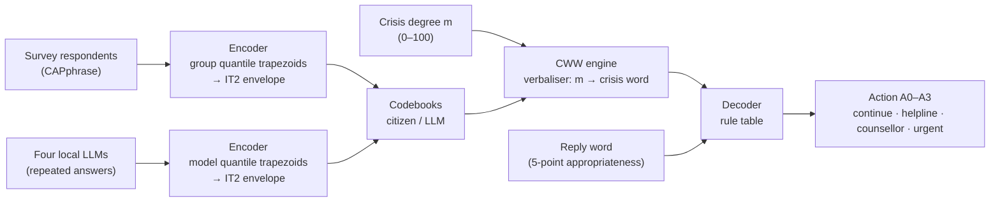

# Same Word, Different Meaning: Respondent vs LLM Word Models for Crisis-Line Risk Communication

A crisis-line chatbot that judges urgency has to put that judgement into words such as *likely* or *realistic
possibility*. This project asks whether survey respondents and large language models (LLMs) mean the same thing by
such probability words, and whether the difference changes the escalation decision of a crisis-line
[Perceptual Computer](#approach). It builds a citizen codebook and an LLM codebook of interval type-2 fuzzy sets,
compares them word by word, and runs both through the same decision rule.

*Seminar Urban Computing, HS2026, Human-IST Institute, University of Fribourg (BeNeFri). Authors: Nikhil Shetty and
Rajeshwar Rao.*

> **Research prototype, not for clinical use.** The escalation rules (`src/cww/rules.py`) are a design proposal and
> are not clinically validated. Nothing in this repository should be used to make decisions about people in crisis.

## Contents

- [Research questions and hypotheses](#research-questions-and-hypotheses)
- [Key results](#key-results)
- [Approach](#approach)
- [Data](#data)
- [Setup](#setup)
- [Reproduce](#reproduce)
- [Repository structure](#repository-structure)
- [Pre-registration and decisions](#pre-registration-and-decisions)
- [Earlier exploratory study](#earlier-exploratory-study)
- [Ethics and licences](#ethics-and-licences)
- [Known issues](#known-issues)
- [How to cite](#how-to-cite)

## Research questions and hypotheses

Worded as in the frozen plan [docs/ANALYSIS_PLAN_WORDS.md](docs/ANALYSIS_PLAN_WORDS.md). The plan calls the survey
side "citizen"; in this project the CAPphrase data are called *respondents*, and "citizen codebook" is the defined term
for the word models built from them.

**Question:** "Do citizens and LLMs mean the same thing by probability words, and does a mismatch change escalation
decisions of a crisis-line Perceptual Computer?"

| | As in the plan | In plain language |
|---|---|---|
| **RQ1** | Citizen word models | What do probability words mean to survey respondents, and how much do demographic groups disagree? |
| **RQ2** | LLM word models | Do four local LLMs mean the same thing by these words, and are their meanings narrower? |
| **RQ3** | Consequence for escalation | Does swapping the citizen codebook for the LLM codebook change the crisis-line action? |
| **H2a** | "mean Jaccard of hedge terms {Realistic Possibility, Could Happen, May Happen, Might Happen, Probable, Likely} < mean Jaccard of extreme terms {Almost No Chance, Almost Certain, Will Happen}." | LLMs and respondents should agree *less* on vague hedge words than on extreme words. |
| **H2b** | "LLM IQR < citizen IQR for a majority of terms (per model and pooled)." | LLMs use most words more narrowly than respondents do. |
| **H3** | "action flip rate LLM vs citizen > 0 (CI excludes 0)." | The word mismatch changes at least some crisis-line actions. |

All tests are exploratory; verdicts follow the CI rule stated in the plan.

## Key results

The numbers live in the generated summaries, not here, so they cannot go stale.

- **RQ1:** respondents agree closely on anchor words such as *Almost No Chance* and *About Even*, and the
  demographic groups differ most on words such as *Unlikely*, *Probable* and *Remote Chance*. → [results/words/rq1/SUMMARY.md](results/words/rq1/SUMMARY.md)
- **RQ2:** LLM meanings overlap only partly with the citizen codebook; H2a is reversed (extremes diverge more than
  hedges), H2b holds for three of four models, and models often collapse a word to one number. →
  [results/words/rq2/SUMMARY.md](results/words/rq2/SUMMARY.md)
- **RQ3:** the LLM codebook flips a small share of actions, all between "continue" and "suggest a helpline", partly
  through a gap in the LLM codebook; H3 is supported, including in two post-hoc sensitivity analyses. →
  [results/words/rq3/SUMMARY.md](results/words/rq3/SUMMARY.md)

## Approach



1. **Encoder:** each respondent group's (or model's) answers for a word become a quantile trapezoid; the envelope over
   groups (or models) is the interval type-2 word model ([docs/METHOD.md](docs/METHOD.md), `src/cww/quantile.py`).
2. **Codebooks:** the citizen codebook comes from respondents, the LLM codebook from the models; both use the same
   encoder, so any difference is a difference in meaning.
3. **CWW engine:** a crisis degree is put into one of four crisis words by largest membership (`src/cww/verbalise.py`).
4. **Decoder:** the crisis word and a reply-quality word select an action A0–A3 from a rule table (`src/cww/rules.py`).

## Data

| Dataset | Role | Licence | Citation / details |
|---|---|---|---|
| **CAPphrase** | Respondents' absolute and pairwise judgements of 19 probability phrases (RQ1, RQ2) | CC-BY 4.0 | Kucharski AJ (2026). *CAPphrase*, [doi:10.5281/zenodo.18750054](https://doi.org/10.5281/zenodo.18750054) (concept DOI; v1.0.0: [10.5281/zenodo.18750055](https://doi.org/10.5281/zenodo.18750055)); [repository](https://github.com/adamkucharski/CAPphrase); [docs/DATA.md](docs/DATA.md#e-capphrase-wp1-data-only) |
| **LLM answers** | Answers of four local models, 2 prompts (RQ2) | Generated by us; committed in [data/llm_answers/](data/llm_answers/) | [experiments/words/elicit_llm.py](experiments/words/elicit_llm.py), decisions D18/D19 |
| **Between Help and Harm (BHH)** | Help-seeking messages from public mental-health datasets, with LLM crisis labels (RQ3) | No licence stated: used for research with citation, not redistributed, no text reproduced | Arnaiz-Rodriguez et al. (2026), [doi:10.2196/88435](https://doi.org/10.2196/88435); [docs/DATA.md](docs/DATA.md#a-between-help-and-harm) |

Raw data are downloaded into `data/raw/` (git-ignored, read-only) and never edited; provenance and SHA-256 hashes are
locked in [data/MANIFEST.json](data/MANIFEST.json).

## Setup

**Reference environment: Python 3.12** with the pins in [requirements.txt](requirements.txt).

```bash
git clone https://github.com/Nikhil5hetty/mental-health-crisis.git
cd mental-health-crisis
python3.12 -m venv .venv
.venv/bin/python -m pip install -r requirements.txt
```

**Python 3.15 note:** `pyarrow==22.0.0` has no wheel for Python 3.15 and fails to build. On 3.15, install the packages
without that pin (pyarrow 26 works with the pinned Streamlit; [app/README.md](app/README.md) lists the app-only
subset):

```bash
.venv/bin/python -m pip install streamlit==1.67.0 numpy pandas matplotlib PyYAML pytest requests openpyxl huggingface_hub
```

**Data for the word study.** Only CAPphrase and Between Help and Harm are needed; both come from public Git
repositories, so no Hugging Face token is required:

```bash
.venv/bin/python -I scripts/fetch_data.py --only capphrase
.venv/bin/python -I scripts/fetch_data.py --only between_help_and_harm
.venv/bin/python -I scripts/verify_data.py
```

`fetch_data.py` downloads the pinned revisions recorded in `data/MANIFEST.json` and skips files that already match.
`verify_data.py` checks every dataset in the manifest: the CAPphrase and BHH checks should pass, and it reports FAIL
(exit code 1) for the earlier study's datasets (CounselBench, MentalAlign, MentalHealthBench) if you did not fetch
them. Those are not needed here.

## Reproduce

Run from the repository root. Every script is offline and deterministic (fixed seeds); a rerun reproduces the
committed files in `results/words/` byte for byte.

1. **Data:** fetch and verify as in [Setup](#setup).
2. **RQ1, citizen codebook** (also writes the descriptive respondent profile, D21):
   ```bash
   .venv/bin/python -I experiments/words/describe_respondents.py
   .venv/bin/python -I experiments/words/run_rq1.py
   ```
3. **RQ2, LLM codebook:** the LLM answers are committed in `data/llm_answers/`, so no model is needed:
   ```bash
   .venv/bin/python -I experiments/words/run_rq2.py
   ```
4. **RQ3, decisions** (also reads the earlier study's committed `results/rq2/per_item.csv` for the reply words):
   ```bash
   .venv/bin/python -I experiments/words/run_rq3.py
   ```
5. **Tests:**
   ```bash
   .venv/bin/python -I -m pytest -q
   ```
6. **Paper** (every number is a macro generated from `results/`; see [paper/README.md](paper/README.md)):
   ```bash
   .venv/bin/python -I paper/scripts/export_numbers.py
   .venv/bin/python -I paper/scripts/export_tables.py
   .venv/bin/python -I paper/scripts/check_numbers.py
   cd paper && make tectonic        # Tectonic (XeTeX); or: make pdf (latexmk, TeX Live) or upload paper/ to Overleaf
   ```
7. **App**, the word-meaning lab (two pages: word meanings and a crisis-line simulator):
   ```bash
   .venv/bin/streamlit run app/word_lab.py
   ```
   Installation manual, user manual and known limitations: [app/README.md](app/README.md).

Steps 2–4 take well under a minute together on a laptop.

### Optional: elicit the LLM answers again (Ollama)

[experiments/words/elicit_llm.py](experiments/words/elicit_llm.py) asks local models what probability each phrase
conveys (prompts P1 and P2, 50 samples per phrase at temperature 1.0, seed 20261124 plus the sample index). A reply is
valid only if it is a bare number in [0, 100], optionally with `%` or a full stop (D19); otherwise the prompt is asked
again in the same conversation, up to 2 times. The models and server are configured in
[experiments/words/models.yaml](experiments/words/models.yaml): `llama3.1:8b`, `qwen2.5:7b`, `gemma2:9b`,
`mistral:7b` on `http://localhost:11434`.

1. Install [Ollama](https://ollama.com/download) (macOS: `brew install ollama`), start it with `ollama serve`, and pull
   the models (about 20 GB): `ollama pull llama3.1:8b` and likewise for the other three.
2. Try it without a model, then on one model:
   ```bash
   .venv/bin/python -I experiments/words/elicit_llm.py --dry-run          # fake model → data/processed/llm_answers_dryrun.csv
   .venv/bin/python -I experiments/words/elicit_llm.py --models llama3.1:8b --samples 2 --out /tmp/smoke.csv
   ```
3. Full run: `.venv/bin/python -I experiments/words/elicit_llm.py`. It is resumable (existing rows are skipped), stores
   each model's digest on every row, and refuses to mix digests for one tag, so do not `ollama pull` during a study.
4. Answers collected under the earlier, looser parser can be moved to `data/llm_answers/superseded.csv` and requested
   again with `--requeue-invalid` (D19). On the committed file this finds nothing to move.

## Repository structure

```text
mental-health-crisis/
├── app/                    word-meaning lab (Streamlit): word_lab.py, views/, README.md
├── data/
│   ├── MANIFEST.json       provenance and SHA-256 lock of all downloaded files
│   ├── llm_answers/        LLM answers generated by us (answers.csv, superseded.csv)
│   └── raw/                downloaded data, git-ignored, read-only
├── docs/                   analysis plans, DECISIONS.md, METHOD.md, DATA.md, AI_USAGE.md, USABILITY.md
├── experiments/words/      word study: elicit_llm.py, run_rq1.py, run_rq2.py, run_rq3.py, describe_respondents.py
├── paper/                  seminar paper (acmart): sections/, scripts/, generated/, Makefile
├── results/words/          rq1/, rq2/, rq3/: SUMMARY.md, metrics, codebooks, figures
├── scripts/                fetch_data.py, verify_data.py
├── src/
│   ├── app/                app logic (unit-tested)
│   ├── cww/                Computing with Words core: sets, centroid, similarity, quantile, verbalise, rules
│   └── data/               read-only loaders (capphrase.py, bhh.py, ...)
└── tests/                  synthetic tests for loaders, CWW core, experiments, app and paper
```

**Earlier exploratory study** (kept because the paper cites it): `experiments/rq1/`, `experiments/rq2/`,
`experiments/counselbench/`, `experiments/demo/`, `experiments/common.py`, `results/rq1/`, `results/rq2/`,
`results/counselbench/`, `results/demo/`, `docs/ANALYSIS_PLAN_RQ2.md`, `docs/ANALYSIS_PLAN_RQ1_DEMO.md`.

## Pre-registration and decisions

- **Plan:** [docs/ANALYSIS_PLAN_WORDS.md](docs/ANALYSIS_PLAN_WORDS.md), frozen in the repository before the data were
  fetched or elicited (internal, commit-timestamped pre-registration; not a public registry).
- **Decisions and deviations:** [docs/DECISIONS.md](docs/DECISIONS.md) (D17–D21 concern this study); each results
  SUMMARY.md has a Deviations section.
- **Method:** [docs/METHOD.md](docs/METHOD.md) for the CWW core.
- **Data provenance and verification:** [docs/DATA.md](docs/DATA.md), [docs/DATA_VERIFICATION.txt](docs/DATA_VERIFICATION.txt).
- **Use of AI tools:** [docs/AI_USAGE.md](docs/AI_USAGE.md).
- **Repository conventions:** [AGENTS.md](AGENTS.md).

## Earlier exploratory study

An earlier CWW study on expert disagreement in crisis-safety judgements (Between Help and Harm, CounselBench)
motivates this work. Its plans and results are in [docs/ANALYSIS_PLAN_RQ2.md](docs/ANALYSIS_PLAN_RQ2.md),
[docs/ANALYSIS_PLAN_RQ1_DEMO.md](docs/ANALYSIS_PLAN_RQ1_DEMO.md) and [results/rq1](results/rq1),
[rq2](results/rq2), [demo](results/demo) and [counselbench](results/counselbench).

## Ethics and licences

- We collected no data from people. The study uses published data (CAPphrase, CC-BY 4.0; Between Help and Harm,
  research use with citation, not redistributed) and answers generated by local models.
- Only aggregate results are committed; no survey record and no message text is reproduced.
- Context: Swiss helplines are **143** (Die Dargebotene Hand), **147** (Pro Juventute, for young people), and the
  emergency numbers **144** (ambulance) and **112** (European emergency number). If you or someone you know is in
  crisis, contact them, not this software.

## Known issues

- `pytest` shows two failures that depend on the environment, not on the word study:
  - `tests/test_integration.py::test_build_processed_references` needs every dataset of the earlier study under
    `data/raw/` (CounselBench, MentalAlign, MentalHealthBench).
  - `tests/test_loaders.py::test_answer_artefacts_parquet_roundtrip` fails with pandas 3.x (a missing value is read
    back as NaN, not None); it passes with the pinned pandas 2.3.3.
- `scripts/verify_data.py` exits with code 1 if the earlier study's datasets were not fetched (see [Setup](#setup)).

## How to cite

```bibtex
@misc{shetty2026sameword,
  author = {Shetty, Nikhil and Rao, Rajeshwar},
  title  = {Same Word, Different Meaning: Respondent vs {LLM} Word Models for Crisis-Line Risk Communication},
  year   = {2026},
  note   = {Seminar paper, Seminar Urban Computing HS2026, Human-IST Institute, University of Fribourg (BeNeFri).
            Code and data: https://github.com/Nikhil5hetty/mental-health-crisis}
}
```

Please also cite the datasets: CAPphrase (Kucharski 2026) and Between Help and Harm (Arnaiz-Rodriguez et al. 2026).
