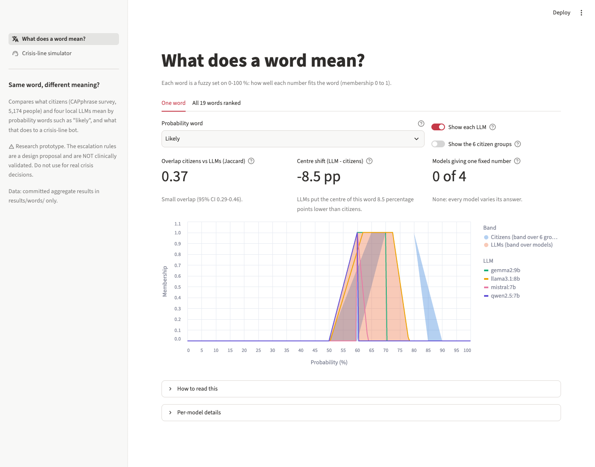
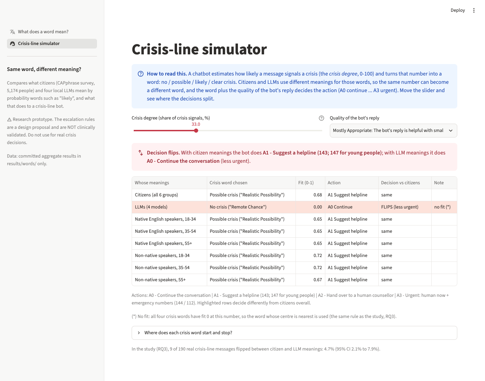

# Word-meaning lab

An interactive prototype (design-science artefact, WP6) for the study *Same word, different meaning*
(`docs/ANALYSIS_PLAN_WORDS.md`). It lets you explore two questions:

1. **What does a word mean?** How citizens (CAPphrase survey, 5,174 respondents) and four local LLMs read
   probability words such as "likely" or "realistic possibility".
2. **Does it matter?** In a crisis-line simulator, the same crisis estimate is put into words with citizen
   meanings and with LLM meanings. Where the word differs, the bot's action can flip.

> **Research prototype.** The escalation rules (`src/cww/rules.py`) are a design proposal. They are **not
> clinically validated** and must not be used for real crisis decisions.

The app reads **only** the committed aggregate results in `results/words/**` (codebooks and metrics). It never
touches raw data, so it starts in about a second and contains no licensed survey or chatbot text.

---

## Installation manual

**Requirements:** Python 3.11 or newer, and the repository checked out with its `results/words/` folder.

```bash
git clone <repository> && cd mental-health-crisis
python3 -m venv .venv
.venv/bin/python -m pip install -r requirements.txt     # includes streamlit==1.67.0
.venv/bin/streamlit run app/word_lab.py
```

Streamlit prints a local address (normally http://localhost:8501) and opens it in your browser.
Stop the app with `Ctrl+C`.

**Tested environment:** macOS (Apple silicon), Python 3.15.2, streamlit 1.67.0, altair 6.3.0, pandas 3.1.1,
numpy 2.5.5, pyarrow 26.0.1. **Python 3.15 note:** the pinned `pyarrow==22.0.0` in `requirements.txt` has no
wheel for Python 3.15 and fails to build. On 3.15, install the app's packages without that pin:

```bash
.venv/bin/python -m pip install streamlit==1.67.0 numpy pandas matplotlib PyYAML pytest
```

**Check the installation:**

```bash
.venv/bin/python -I -m pytest -q tests/test_word_lab.py      # logic tests + Streamlit smoke tests of both pages
```

**Other results folder (optional):** set `WORD_LAB_RESULTS=/path/to/results/words` before `streamlit run`.
The tests use this to run the app on small synthetic results.

If a required result file is missing, the page says which file is missing and which script produces it, for
example `rq2/codebooks/llm_it2.csv (made by python -I experiments/words/run_rq2.py)`.

---

## User manual

Use the left sidebar to switch between the two pages.

### Page 1: What does a word mean?



1. **Pick a probability word** in the drop-down menu (default: "Likely").
2. Read the **chart**. The horizontal axis is a probability from 0 to 100 %. The height (*membership*, 0 to 1)
   shows how well each number fits the word.
   - **Blue band:** citizens. Its lower and upper edges come from six demographic groups (native or non-native
     English speakers, in three age bands). A wide band means the groups disagree.
   - **Orange band:** the four LLMs together (question wording P1, 50 answers per model).
   - **Coloured lines:** one LLM each. A tall thin spike means the model gave the same number almost every time
     (a *collapsed* model).
3. Use the **toggles** to show or hide each LLM's line and the six citizen-group lines.
4. Read the three **headline numbers**:
   - **Overlap (Jaccard):** 0 means the two bands do not overlap, 1 means they are identical.
   - **Centre shift:** how many percentage points higher (+) or lower (-) the LLMs place the word than citizens do.
   - **Models giving one fixed number:** how many models collapsed for this word.

   Hover over the ⓘ icon for the 95 % confidence interval.
5. A yellow note appears when a model was left out for this word because it gave fewer than 30 valid answers.
6. **Per-model details** shows each model's quantiles, its overlap with citizens and its spread ratio.
7. The **All 19 words ranked** tab orders every word by overlap, with confidence intervals. Hedge and extreme
   words (hypothesis H2a) are coloured. Hover over a dot for its numbers.

### Page 2: Crisis-line simulator



1. Set the **crisis degree** slider (0–100). In the study this is the share of LLM labellers who marked a message
   as a crisis.
2. Choose the **quality of the bot's reply**, from *Harmful/Unacceptable* to *Fully Appropriate*.
3. The banner gives the verdict:
   - **Red "Decision flips"** means citizen meanings and LLM meanings lead to different actions. The banner says
     whether the LLM decision is more or less urgent.
   - **Green "Same decision"** means both lead to the same action.
4. The **table** has one row per set of meanings: citizens overall, the LLMs, and each of the six citizen groups.
   Each row shows the crisis word chosen, how well it fits (0–1) and the resulting action:
   - **A0:** continue the conversation.
   - **A1:** suggest a helpline (143; 147 for young people).
   - **A2:** hand over to a human counsellor.
   - **A3:** urgent: a human now, plus the emergency numbers 144 / 112.

   Highlighted rows decide differently from citizens overall.
5. **No fit (\*)** means none of the four crisis words fits that number at all, so the word with the nearest
   centre is used. This is the same rule as in the study (RQ3).
6. **Where does each crisis word start and stop?** shows the four crisis words for citizens and for LLMs, with
   your slider position marked. Gaps (no line above 0) are numbers that no word covers.
7. The footnote gives the study result (RQ3: how many of the 190 real messages flipped). If
   `results/words/rq3` is missing, the simulator still works, because it needs only the codebooks and the rule
   table, and the footnote says so.

**Try this:** set the slider to 33 with *Mostly Appropriate*. Citizens call 33 % a *possible* crisis and suggest
a helpline; the LLM codebook has no word for about 33 %, falls back to *no crisis*, and the bot just continues.

---

## How it is built

| Part | File | Role |
| --- | --- | --- |
| Entry point and navigation | `app/word_lab.py` | page set-up, sidebar, disclaimer |
| Page 1 | `app/views/meaning.py` | thin UI: widgets and charts only |
| Page 2 | `app/views/simulator.py` | thin UI: widgets and table only |
| Logic | `src/app/logic.py` | loading, validation, curves, summaries, simulation (unit-tested) |
| Decision rule | `src/cww/verbalise.py` | **shared** with `experiments/words/run_rq3.py`: the same code, not a copy |
| Tests | `tests/test_word_lab.py` | logic tests on synthetic results, consistency with RQ3, AppTest smoke tests |

A test checks that the simulator reproduces the committed RQ3 decisions for all 190 study items.

---

## Known limitations

- **Not a clinical tool.** The rule table is an unvalidated design proposal, and the crisis degree is a study
  construct (share of LLM labellers), not a real-time risk score.
- **Only one question wording.** The LLM codebook uses prompt P1. The persona prompt P2 is in the study results
  (`results/words/rq2/sensitivity.csv`) but not in the app.
- **The LLM band depends on four specific local models** (pinned digests in `results/words/rq2/SUMMARY.md`).
  Other models or versions can mean different things.
- **Collapsed models** (one fixed number) show up as single-point spikes, which are hard to see at some zoom
  levels. The headline counter and the per-model table always list them.
- **Fallback rule.** When no crisis word fits, the nearest-centre fallback decides. At about 33 % it causes some of
  the flips shown (see `results/words/rq3/SUMMARY.md`, post-hoc section).
- **Group lines** are T1 sets of six demographic groups only. Smaller groups such as under-18s or a missing
  age are not shown.
- **Uncertainty** is shown as 95 % bootstrap intervals from the study. The app does not recompute them.
- **Accessibility:** colours come from a reference categorical palette designed for colour-vision deficiencies,
  but this exact combination has not been re-validated. Every series is also named in a legend and tooltip, so
  colour is never the only cue. The app has not been tested with a screen reader.
- **Local use only.** There is no login or multi-user state. Streamlit's development server is not hardened for
  public deployment.
